# Happy Products — WarehousePOS Operations Manual

**System Edition:** Desktop v1.0 (Windows x64)  
**Architecture:** 100% Offline Single-PC Monolith  
**Database:** SQLite (`C:\ProgramData\WarehousePOS\Data\WarehousePOS.db`)  
**Hardware Printing:** Epson LQ-310 Continuous 9.5" × 5.5" Dot-Matrix  
**Compiled PDF Document:** [`WarehousePOS_User_Manual.pdf`](file:///d:/WarehousePOS/WarehousePOS_User_Manual.pdf) | [`docs/WarehousePOS_User_Manual.pdf`](file:///d:/WarehousePOS/docs/WarehousePOS_User_Manual.pdf)

---

## 📋 Table of Contents & Visual Navigation Map

1. [System Overview & Architecture](#1-system-overview--architecture)
2. [Sign-In Screen & Credentials Entry](#2-sign-in-screen--credentials-entry)
3. [Sidebar Navigation Architecture](#3-sidebar-navigation-architecture)
4. [Point of Sale (Cash) Terminal](#4-point-of-sale-cash-terminal)
5. [Bill History & Invoices](#5-bill-history--invoices)
6. [Epson LQ-310 Receipt Printing & Preview](#6-epson-lq-310-receipt-printing--preview)
7. [Product Catalog & Inventory Management](#7-product-catalog--inventory-management)
8. [Purchasing & Stock Inbound (GRN)](#8-purchasing--stock-inbound-grn)
9. [Supplier Directory & Accounts Payable](#9-supplier-directory--accounts-payable)
10. [Customer Directory & Credit Management](#10-customer-directory--credit-management)
11. [Warehouse Operational Expenses](#11-warehouse-operational-expenses)
12. [Reports & Executive Analytics](#12-reports--executive-analytics)
13. [User Management & Payroll Setup](#13-user-management--payroll-setup)
14. [Store Profile, Printer & Backup Settings](#14-store-profile-printer--backup-settings)
15. [Daily Checklists & Keyboard Shortcuts](#15-daily-checklists--keyboard-shortcuts)

---

## 1. System Overview & Architecture

**WarehousePOS** is a single-PC, fully offline desktop management system custom-built for **Happy Products** (Authorised Dealer for Damro, Abans, Singer, Soft Logic, and Arpico). The system unifies retail point-of-sale, warehouse inventory control, supplier procurement, customer accounts receivable, and industrial dot-matrix receipt printing into an integrated solution.

### Operating Environment & File System Layout

| Resource | Filesystem Path | Retention Policy |
| :--- | :--- | :--- |
| **Live Database** | `C:\ProgramData\WarehousePOS\Data\WarehousePOS.db` | Primary SQLite database; never delete or move |
| **Automatic Backups** | `C:\ProgramData\WarehousePOS\Backups\` | Snapshot created on first application launch daily |
| **Diagnostics & Logs** | `C:\ProgramData\WarehousePOS\Logs\application.log` | Serilog rolling logs; retained for 30 days |
| **Desktop Binary** | `C:\Program Files\WarehousePOS\WarehousePOS.Desktop.exe` | Self-contained x64 Windows desktop executable |

---

## 2. Sign-In Screen & Credentials Entry

The system is launched via the **Happy Products POS** desktop shortcut. Authentication uses BCrypt password hashing and maintains an immutable audit log.

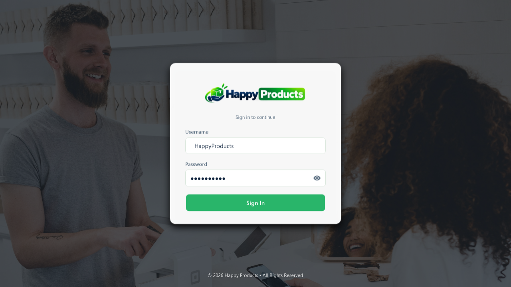
*Figure 2.1: Actual Happy Products Sign-In Window displaying entry of sample credentials.*

### Logging In with Sample Data:
1. **Username:** Click into the *Username* box and enter your assigned user handle. For demonstration purposes, sample credentials `HappyProducts` (or cashier accounts `cashier1`, `cashier2`) may be entered.
2. **Password:** Click into the *Password* box and type the password (masked with security bullets `••••••••••`). The eye toggle icon on the right can be clicked to momentarily unmask the input.
3. **Sign In:** Click **Sign In** or press <kbd>Enter</kbd> to enter the main application.

---

## 3. Sidebar Navigation Architecture

The main shell hosts a persistent left navigation sidebar with visual state indicators (green background and left accent bar for the active page).

| Sidebar Button | Target View | Required Role | Hotkey |
| :--- | :--- | :---: | :---: |
| **🖥️ Point of Sale** | Point of Sale (Cash) Terminal | Worker / Admin | <kbd>Ctrl+1</kbd> |
| **🧾 Bill History** | Bill History & Invoices | Worker / Admin | <kbd>Ctrl+2</kbd> |
| **📦 Products** | Product Catalog & Inventory | Worker / Admin | <kbd>Ctrl+3</kbd> |
| **🛒 Purchasing** | Purchasing & Stock Inbound (GRN) | Admin / Manager | <kbd>Ctrl+4</kbd> |
| **🚚 Suppliers** | Supplier Directory & Balances | Admin / Manager | <kbd>Ctrl+5</kbd> |
| **👥 Customers** | Customer Directory & Credit | Worker / Admin | <kbd>Ctrl+6</kbd> |
| **📊 Reports** | Executive Analytics & Reports | Admin Only | <kbd>Ctrl+7</kbd> |
| **💸 Expenses** | Operational Expenses Tracking | Admin Only | <kbd>Ctrl+8</kbd> |
| **🔐 User Management** | User Accounts & Payroll Setup | Admin Only | <kbd>Ctrl+9</kbd> |
| **⚙️ Settings** | Store Profile & Hardware Config | Admin Only | <kbd>Ctrl+0</kbd> |
| **⬅ Logout** | Returns to Login Window | All Users | <kbd>Alt+L</kbd> |

---

## 4. Point of Sale (Cash) Terminal

> **How to Navigate:** Click **🖥️ Point of Sale** on the left navigation sidebar or press <kbd>F1</kbd>.

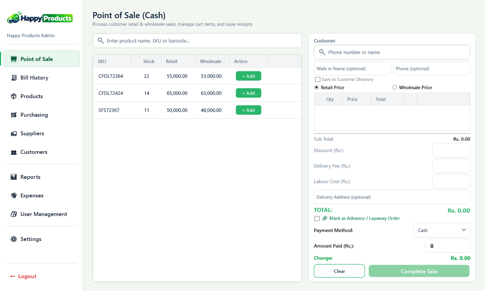
*Figure 4.1: Actual Point of Sale (Cash) Terminal view.*

### On-Screen Operations:
1. **Product Lookup:** Type SKU (e.g., `CFDL72364`), name, or scan barcode into the top search bar.
2. **Add to Cart:** Click the green **+ Add** button on the product catalog row.
3. **Customer Details:** Defaults to Walk-in Customer. Enter optional *Walk-in Name* and *Phone*, and check *Save to Customer Directory* to register the buyer for future sales.
4. **Price Tier:** Select **Retail Price** or **Wholesale Price** radio buttons.
5. **Adjustments:** Enter optional *Discount (Rs.)*, *Delivery Fee (Rs.)*, or *Labour Cost (Rs.)*.
6. **Payment & Receipt:** Enter *Amount Paid (Rs.)*. Change due calculates immediately. Click **Complete Sale** (or press <kbd>F12</kbd>) to complete transaction, decrement stock, and print receipt.

---

## 5. Bill History & Invoices

> **How to Navigate:** Click **🧾 Bill History** on the left navigation sidebar.

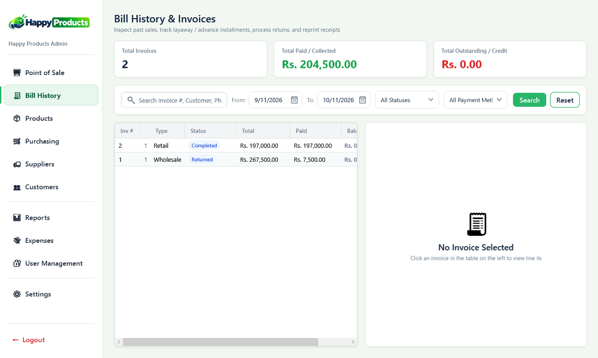
*Figure 5.1: Actual Bill History & Invoices screen.*

### On-Screen Operations:
- **Metrics:** Review *Total Invoices*, *Total Paid / Collected (Rs.)*, and *Total Outstanding (Rs.)*.
- **Search & Filter:** Search by Invoice #, customer phone, date range (From / To), Status (Completed, Returned, Layaway), or Payment Method.
- **Invoice Review & Reprint:** Click any row in the invoice table to view full line-item details on the right pane, and click **Reprint Receipt** to send the bill to the printer.

---

## 6. Epson LQ-310 Receipt Printing & Preview

Receipts are printed on continuous tractor-feed 9.5" × 5.5" (half-page) 2-ply NCR paper via an **Epson LQ-310 Dot-Matrix Printer**.

*Figure 6.1: Dot-Matrix Receipt Preview showing store header, itemized list, warranty terms, and barcode.*

---

## 7. Product Catalog & Inventory Management

> **How to Navigate:** Click **📦 Products** on the left navigation sidebar.

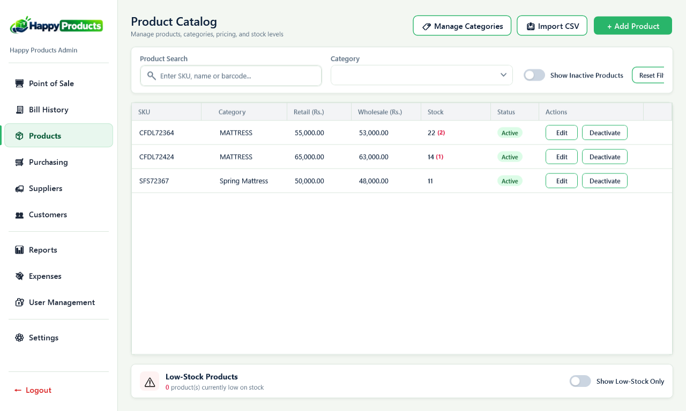
*Figure 7.1: Actual Product Catalog screen.*

### On-Screen Operations:
- **Add Product:** Click the green **+ Add Product** button to open the product entry modal (SKU, barcode, category, cost price, retail price, wholesale price, and reorder level).
- **Manage Categories:** Click **Manage Categories** to add or modify product departments.
- **Import CSV:** Batch import large product catalogs using the **Import CSV** tool.
- **Low-Stock Alert:** View low-stock warning banners at the bottom and use the *Show Low-Stock Only* toggle switch for quick reordering.
- **Edit & Deactivate:** Modify details with **Edit**; use **Deactivate** to safely soft-delete products without breaking past sales records.

---

## 8. Purchasing & Stock Inbound (GRN)

> **How to Navigate:** Click **🛒 Purchasing** on the left navigation sidebar (Admin / Manager role).

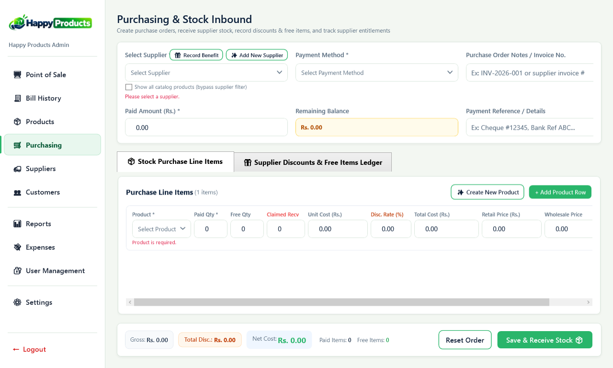
*Figure 8.1: Actual Purchasing & Stock Inbound screen.*

### On-Screen Operations:
1. **Supplier:** Choose supplier from the *Select Supplier* dropdown.
2. **Order Info:** Enter supplier invoice number and payment method.
3. **Line Items:** Add products, *Paid Qty*, *Free Qty* (bonus stock), *Unit Cost (Rs.)*, and *Discount Rate (%)*.
4. **Payment:** Record *Paid Amount (Rs.)* to compute *Remaining Balance*.
5. **Receive Stock:** Click **Save & Receive Stock** to atomically increment warehouse inventory and update the supplier's payable ledger.

---

## 9. Supplier Directory & Accounts Payable

> **How to Navigate:** Click **🚚 Suppliers** on the left navigation sidebar.

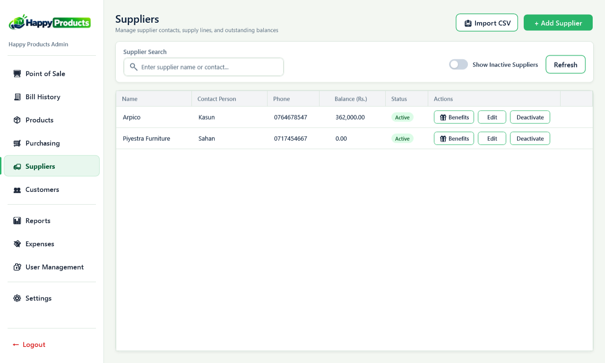
*Figure 9.1: Actual Suppliers management screen.*

### On-Screen Operations:
- View vendor profiles (Company Name, Contact Person, Phone, and current **Balance (Rs.)** owed).
- Click **+ Add Supplier** to register a new vendor.
- Click **Benefits** to manage contractual discounts, rebates, or free-item entitlements.
- Record payments made by cheque or bank transfer to decrease outstanding payable balances.

---

## 10. Customer Directory & Credit Management

> **How to Navigate:** Click **👥 Customers** on the left navigation sidebar.

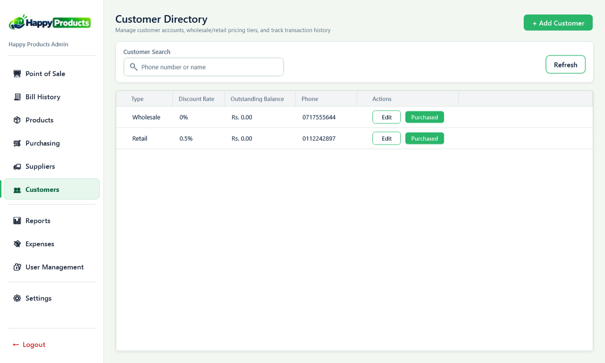
*Figure 10.1: Actual Customer Directory screen.*

### On-Screen Operations:
- Search customers by name or phone number.
- Manage customer accounts (Retail / Wholesale), assigned discount rates, and credit balances.
- Click **Purchased** to review a customer's lifetime purchase history and check warranty validity.
- Click **+ Add Customer** to register new trade accounts and credit limits.

---

## 11. Warehouse Operational Expenses

> **How to Navigate:** Click **💸 Expenses** on the left navigation sidebar (Admin access).

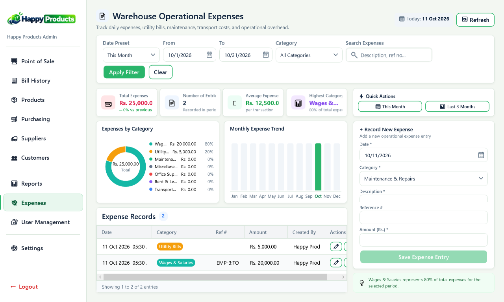
*Figure 11.1: Actual Warehouse Operational Expenses screen.*

### On-Screen Operations:
- Review summary cards: *Total Expenses*, *Number of Entries*, *Average Expense*, and *Highest Category*.
- View interactive charts: *Expenses by Category* donut chart and *Monthly Expense Trend* chart.
- Record expenses using the right panel: Select Date, Category (Utilities, Rent, Transport, etc.), enter description, amount, and click **Save Expense Entry**.

---

## 12. Reports & Executive Analytics

> **How to Navigate:** Click **📊 Reports** on the left navigation sidebar (Admin access).

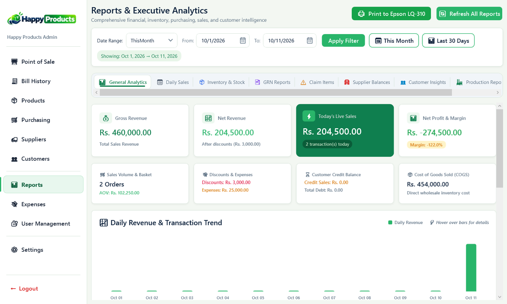
*Figure 12.1: Actual Reports & Executive Analytics dashboard.*

### On-Screen Operations:
- Monitor live KPI cards: *Gross Revenue*, *Net Revenue*, *Today's Live Sales*, *Net Profit & Margin*, and *Cost of Goods Sold (COGS)*.
- Inspect the interactive *Daily Revenue & Transaction Trend* chart.
- Access dedicated intelligence tabs: *General Analytics*, *Daily Sales*, *Inventory & Stock*, *GRN Reports*, *Supplier Balances*, and *Customer Insights*.
- Click **Print to Epson LQ-310** to print report summaries.

---

## 13. User Management & Payroll Setup

> **How to Navigate:** Click **🔐 User Management** on the left navigation sidebar (Admin access).

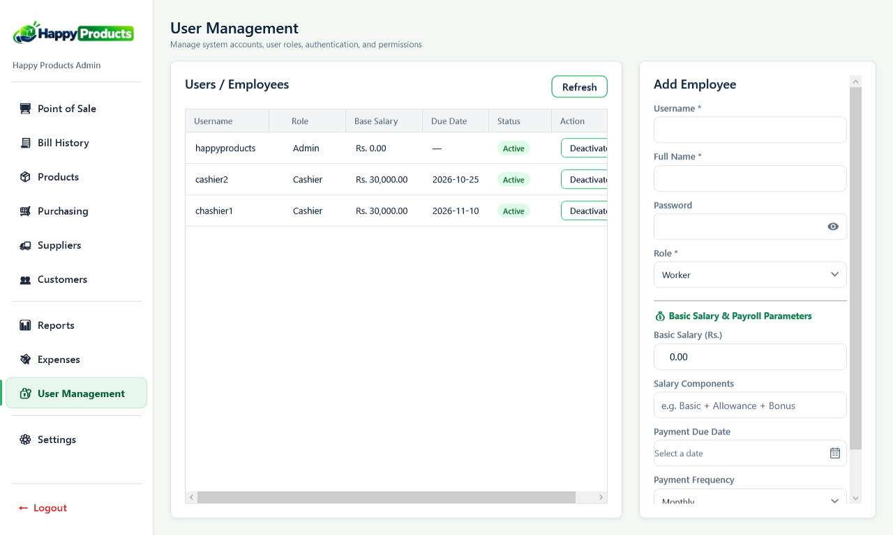
*Figure 13.1: Actual User Management screen.*

### On-Screen Operations:
- Review staff accounts, assigned roles (*Admin*, *Cashier*, *Worker*), and base salaries.
- Register new staff using the *Add Employee* panel: enter Username, Full Name, Temporary Password, select Role, set Basic Salary (Rs.), and click **Save User**.
- Click **Deactivate** to revoke access safely while preserving historical records.

---

## 14. Store Profile, Printer & Backup Settings

> **How to Navigate:** Click **⚙️ Settings** on the left navigation sidebar (Admin access).

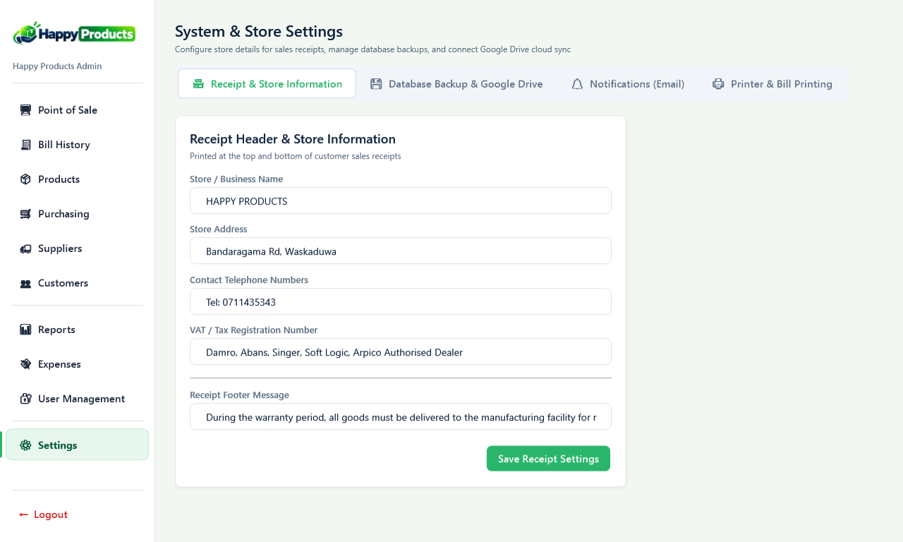
*Figure 14.1: Actual System & Store Settings screen.*

### On-Screen Operations:
- **Receipt & Store Information:** Edit store name (`HAPPY PRODUCTS`), address (`Bandaragama Rd, Waskaduwa`), phone (`Tel: 0711435343`), dealership endorsements, and warranty footer text. Click **Save Receipt Settings**.
- **Database Backup:** Trigger manual on-demand snapshots saved to `C:\ProgramData\WarehousePOS\Backups\`.
- **Printer Configuration:** Select `EPSON LQ-310 ESC/P2`, continuous tractor paper, and auto-print options.

---

## 15. Daily Checklists & Keyboard Shortcuts

### Opening Checklist:
1. Boot PC; verify system date/time.
2. Turn on Epson LQ-310; verify 2-ply tractor paper alignment and ribbon darkness.
3. Connect USB barcode scanner.
4. Launch WarehousePOS, log in with credentials, and verify opening cash drawer float.

### Closing Checklist:
1. Open **Reports** ➔ *Today's Live Sales*; reconcile register totals with cash drawer.
2. Print daily closing summary on the Epson LQ-310.
3. Open **Settings** ➔ *Database Backup*, click **Backup Database Now**.
4. Log out and shut down computer.

### Keyboard Shortcuts Reference:
- <kbd>F1</kbd>: Focus Product Search (POS)
- <kbd>F2</kbd>: Focus Customer Search (POS)
- <kbd>F4</kbd>: Toggle Retail / Wholesale Price (POS)
- <kbd>F8</kbd>: Focus Discount Field (POS)
- <kbd>F9</kbd>: Focus Cash Amount Paid (POS)
- <kbd>F12</kbd> or <kbd>Ctrl+Enter</kbd>: Complete Sale & Print Bill
- <kbd>Ctrl+P</kbd>: Reprint Last Receipt
- <kbd>Esc</kbd>: Clear Search / Close Modal Window

---

*Happy Products WarehousePOS Operations Manual &copy; 2026. All rights reserved.*
